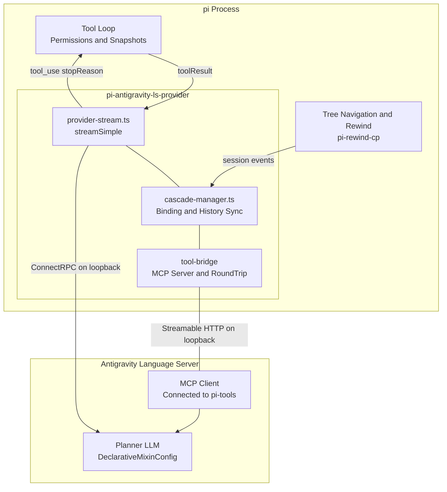
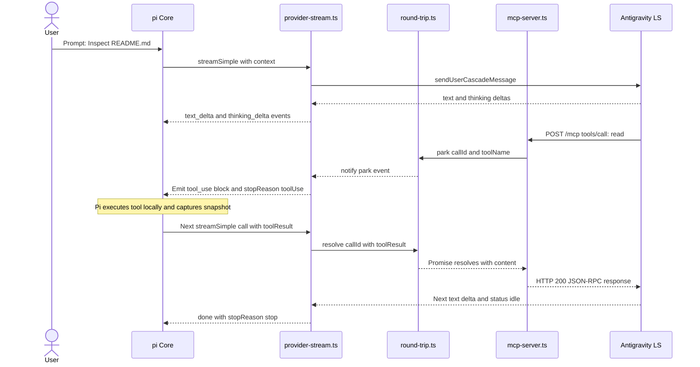
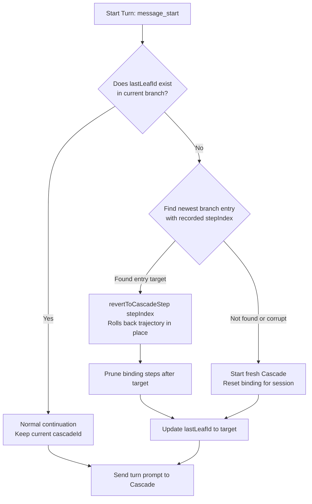

# Architecture & Internal Design

This document details the internal architecture, protocol contracts, round-trip mechanics, and history synchronization mechanisms of `pi-antigravity-ls-provider`.

---

## 1. High-Level Architecture

The extension acts as a bidirectional translation bridge between **Pi's streaming tool loop** and **Google Antigravity's Language Server (LS)**.



### Component Responsibilities

| Component | Responsibility | Does NOT Handle |
|---|---|---|
| **Pi Host** | Source of truth for conversation history and tree branches. Executes all tools locally and captures undo snapshots. | Antigravity protocol or process management. |
| **pi-antigravity-ls-provider** | Translates Cascade events into Pi's event stream. Proxies Pi tools via MCP. Synchronizes rewind states via `revertToCascadeStep`. | Direct tool execution on disk; let Pi handle it. |
| **antigravity-client** | ConnectRPC client library. Manages low-level TLS and Protobuf message packing. | Pi-specific adapter logic or MCP bridging. |
| **Antigravity LS** | Hosts the model planner (LLM), context management, and reasoning loops. | Executing file modifications directly (all builtins disabled). |
| **pi-rewind-cp** | Captures per-file CoW snapshots around Pi's `write`/`edit` tool calls. | Conversation branch syncing (delegated to provider). |

---

## 2. MCP Round-Trip Mechanics

Because Antigravity's models expect tools to be served via MCP, the extension runs a local **Streamable HTTP MCP server** on `127.0.0.1`.

### The Park-and-Resolve Cycle

When the model decides to invoke a tool (e.g. `read` or `bash`):



### Multiple Sequential & Concurrent Tool Calls

A single turn may trigger multiple tool calls:
- **Sequential Calls**: The model receives one tool result, reasons further, and issues another tool call. Each call cycles through `park` → `toolUse` termination → Pi execution → `resolve` on next `streamSimple` turn.
- **Concurrent Calls**: When the model issues parallel tool calls, `round-trip.ts` tracks each active `callId` in a `Map<string, ParkedCall>`. Pi resolves tool results individually. The turn is only marked complete (`status: "idle"`) when all parked promises have been resolved.

---

## 3. Tool Exclusion via DeclarativeMixinConfig

Antigravity's standard `conversational` planner defaults to injecting 13 internal tools (`read_file`, `write_file`, `edit_file`, `run_command`, etc.). Simply passing `forceDisable` flags leaves internal handlers active.

To guarantee that the model **never sees or calls** Antigravity's built-in tools, this provider configures `plannerTypeConfig` with **`declarativeMixinConfig`**:

```typescript
plannerConfig: {
  plannerTypeConfig: {
    case: "declarativeMixinConfig",
    value: {
      // 1. Whitelist ONLY tools from "pi-tools" MCP server
      tools: [
        {
          match: { case: "pattern", value: ".*" },
          source: { case: "providerName", value: "pi-tools" },
        },
      ],
      // 2. Override default prompt sections with pure Pi instructions
      promptSections: [
        {
          item: {
            case: "custom",
            value: {
              title: "pi_system",
              content: combinedPrompt,
            },
          },
        },
      ],
    },
  },
}
```

### Resulting Function Schema
The function schema presented to the model contains only Pi's active tools (e.g. `read`, `write`, `edit`, `bash`). Built-in file and shell tools are excluded at the schema level.

---

## 4. History Rewind & Branch Synchronization

Pi maintains conversation trees allowing non-linear navigation (`/tree`, `/rewind`). Antigravity's LS stores conversations as flat trajectories (`Step[]`).

### Binding Structure
The provider persists branch state in `~/.pi/agent/pi-antigravity-ls/bindings.json`:

```jsonc
{
  "sessions": {
    "<piSessionId>": {
      "cascadeId": "c4d3...",
      "lastLeafId": "<piMessageEntryId>",
      "steps": {
        "<entryId_1>": 2,
        "<entryId_2>": 4,
        "<entryId_3>": 7
      }
    }
  }
}
```

### Rewind Algorithm



1. **Detection**: On `message_start`, the provider checks if `binding.lastLeafId` exists in the incoming branch.
   - If present: the user is appending messages normally.
   - If absent: the user rewound history or branched to an alternate node.
2. **Reversion**: The provider scans backwards along the current branch to find the closest ancestor with a recorded `stepIndex`, then invokes:
   ```typescript
   await client.lsClient.revertToCascadeStep({
     cascadeId: binding.cascadeId,
     stepIndex: targetStepIndex,
     overrideConfig: buildCascadeConfig(...),
   });
   ```
3. **Synchronization**: Trajectory steps beyond `targetStepIndex` are dropped on both sides, ensuring the model's working memory matches the editor state.

---

## 5. Token Usage & Telemetry

Antigravity models stream reasoning and response tokens, but usage statistics are finalized at turn completion.

Upon transitioning to `status: "idle"`, the provider queries:
```typescript
const genMeta = await client.lsClient.getCascadeTrajectoryGeneratorMetadata({
  cascadeId: cascade.cascadeId,
});
```
It extracts `ChatModelMetadata.usage`:
- `inputTokens` → `message.usage.input`
- `outputTokens` → `message.usage.output`
- `thinkingOutputTokens` → accounted in total
- `cacheReadTokens` / `cacheWriteTokens` → `message.usage.cacheRead` / `cacheWrite`

This ensures Pi's token counters and status bars reflect exact counts.
