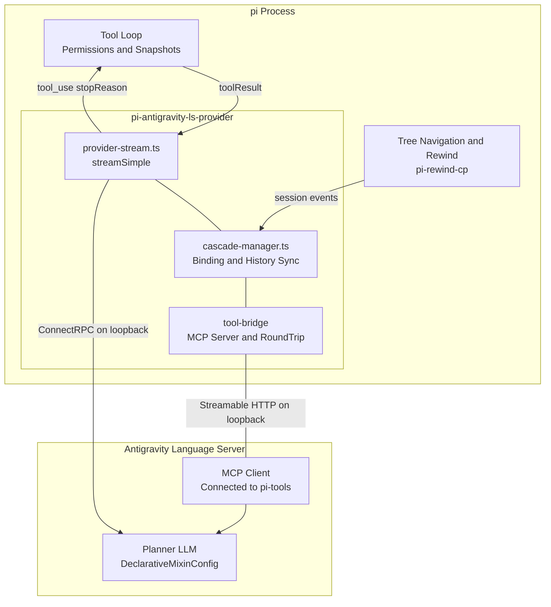
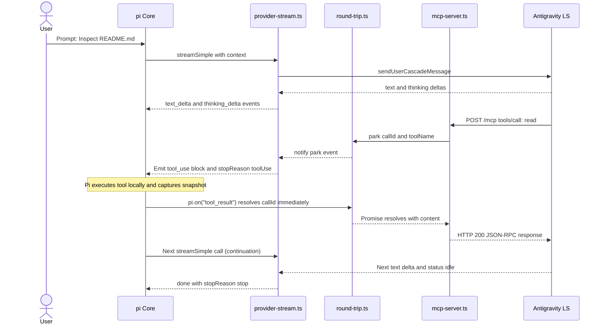
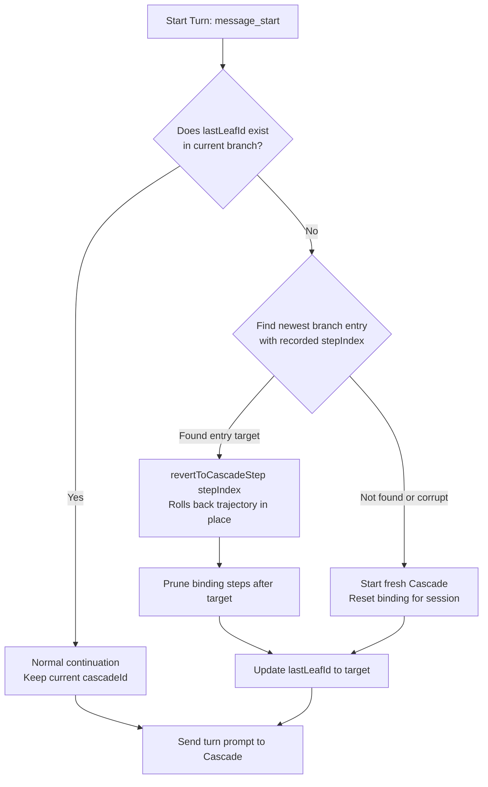
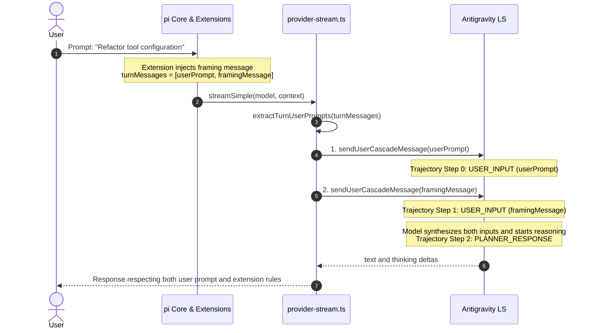

# Architecture & Internal Design

This document details the internal architecture, protocol contracts, round-trip mechanics, and history synchronization mechanisms of `pi-antigravity-ls-provider`.

---

## 1. High-Level Architecture

The extension acts as a bidirectional translation bridge between **Pi's streaming tool loop** and **Google Antigravity's Language Server (LS)**.



### Component Responsibilities

| Component | Responsibility | Does NOT Handle |
|---|---|---|
| **Pi Host** | Source of truth for conversation history and tree branches. Executes all tools locally and captures undo snapshots. | Antigravity protocol or process management. |
| **pi-antigravity-ls-provider** | Translates Cascade events into Pi's event stream. Proxies Pi tools via MCP. Synchronizes rewind states via `revertToCascadeStep`. | Direct tool execution on disk; let Pi handle it. |
| **antigravity-client** | ConnectRPC client library. Manages low-level TLS and Protobuf message packing. | Pi-specific adapter logic or MCP bridging. |
| **Antigravity LS** | Hosts the model planner (LLM), context management, and reasoning loops. | Executing file modifications directly (all builtins disabled). |
| **pi-rewind-cp** | Captures per-file CoW snapshots around Pi's `write`/`edit` tool calls. | Conversation branch syncing (delegated to provider). |

---

## 2. MCP Round-Trip Mechanics

Because Antigravity's models expect tools to be served via MCP, the extension runs a local **Streamable HTTP MCP server** on `127.0.0.1`.

### The Park-and-Resolve Cycle

When the model decides to invoke a tool (e.g. `read` or `bash`):



### Multiple Sequential & Concurrent Tool Calls

A single turn may trigger multiple tool calls:
- **Sequential Calls**: The model receives one tool result, reasons further, and issues another tool call. Each call cycles through `park` → `toolUse` termination → Pi execution → immediate `resolve` via `pi.on("tool_result")` → next `streamSimple` turn.
- **Concurrent Calls**: When the model issues parallel tool calls, `round-trip.ts` tracks each active `callId` in a `Map<string, ParkedCall>`. Pi resolves tool results individually. The turn is only marked complete (`status: "idle"`) when all parked promises have been resolved.
- **Terminating Tool Calls**: Custom tools returning `terminate: true` (e.g. `plannotator_submit_plan`, `structured-output`) end the agent run without an automatic follow-up LLM turn. The tool call is resolved immediately via `pi.on("tool_result")`, and Pi's `agent_settled` hook deterministically calls `cascade.cancel()` to halt any background planner loop in LS, ensuring LS transitions cleanly to `status: "idle"`.

---

## 3. Tool Exclusion via DeclarativeMixinConfig

Antigravity's standard `conversational` planner defaults to injecting 13 internal tools (`read_file`, `write_file`, `edit_file`, `run_command`, etc.). Simply passing `forceDisable` flags leaves internal handlers active.

To guarantee that the model **never sees or calls** Antigravity's built-in tools, this provider configures `plannerTypeConfig` with **`declarativeMixinConfig`**:

```typescript
plannerConfig: {
  plannerTypeConfig: {
    case: "declarativeMixinConfig",
    value: {
      // 1. Whitelist ONLY tools from "pi-tools" MCP server
      tools: [
        {
          match: { case: "pattern", value: ".*" },
          source: { case: "providerName", value: "pi-tools" },
        },
      ],
      // 2. Pass pi's system prompt through unchanged
      promptSections: [
        {
          item: {
            case: "custom",
            value: {
              title: "pi_system",
              content: systemPrompt,
            },
          },
        },
      ],
    },
  },
}
```

### Resulting Function Schema
The function schema presented to the model contains only pi's **active** tools (those returned by `pi.getActiveTools()`). `pi.getAllTools()` also lists registered-but-inactive tools (`grep`, `ls`, `find`, `powershell`, `deferred` MCP tools, ...) and none of those are published over MCP. There is no hardcoded exclusion list: the active set is the single source of truth.

If pi changes its active tool set mid-session (plan mode, `tool_search`, `--tools` modifiers), `McpBridgeServer.consumeToolSetChanged()` notices the difference and `provider-stream.ts` calls `refreshMcpServers()` so the LS tool schema matches the new set before the next prompt is dispatched.

The system prompt is passed through unchanged. The provider does not prepend any extra tool directive, because pi already builds its `<tools>` and `<rules>` sections describing exactly the tool set it declared.

---

## 4. History Rewind & Branch Synchronization

Pi maintains conversation trees allowing non-linear navigation (`/tree`, `/rewind`). Antigravity's LS stores conversations as flat trajectories (`Step[]`).

### Binding Structure
The provider persists branch state in `~/.pi/agent/pi-antigravity-ls/bindings.json`:

```jsonc
{
  "sessions": {
    "<piSessionId>": {
      "cascadeId": "c4d3...",
      "lastLeafId": "<piMessageEntryId>",
      "steps": {
        "<entryId_1>": 2,
        "<entryId_2>": 4,
        "<entryId_3>": 7
      }
    }
  }
}
```

### Rewind Algorithm



1. **Detection**: On `message_start`, the provider checks if `binding.lastLeafId` exists in the incoming branch.
   - If present: the user is appending messages normally.
   - If absent: the user rewound history or branched to an alternate node.
2. **Reversion**: The provider scans backwards along the current branch to find the closest ancestor with a recorded `stepIndex`, then invokes:
   ```typescript
   await client.lsClient.revertToCascadeStep({
     cascadeId: binding.cascadeId,
     stepIndex: targetStepIndex,
     overrideConfig: buildCascadeConfig(...),
   });
   ```
3. **Synchronization**: Trajectory steps beyond `targetStepIndex` are dropped on both sides, ensuring the model's working memory matches the editor state.

---

## 5. Token Usage & Telemetry

Antigravity models stream reasoning and response tokens, but usage statistics are finalized at turn completion.

Upon transitioning to `status: "idle"`, the provider queries:
```typescript
const genMeta = await client.lsClient.getCascadeTrajectoryGeneratorMetadata({
  cascadeId: cascade.cascadeId,
});
```
It extracts `ChatModelMetadata.usage`:
- `inputTokens` → `message.usage.input`
- `outputTokens` → `message.usage.output`
- `thinkingOutputTokens` → accounted in total
- `cacheReadTokens` / `cacheWriteTokens` → `message.usage.cacheRead` / `cacheWrite`

This ensures Pi's token counters and status bars reflect exact counts.

---

## 6. Multi-Message Turns & Sequential Dispatching

### Background: Extension Injections & Multi-Prompt Turns

In Pi's architecture, extensions can inject contextual directives (such as Plannotator's planning-phase framing or workflow state) alongside user prompts via `custom_message` entries. When normalized for LLM dispatch (`convertToLlm`), these custom messages are projected as `role: "user"` messages.

Consequently, a single prompt turn from the user may yield multiple consecutive `user` messages in `context.messages`:
1. `user` message: The user's actual prompt text.
2. `user` message (from `custom_message`): Extension instructions (e.g. `[PLANNOTATOR - PLANNING PHASE]...`).

### The Sequential Dispatch Architecture

Antigravity Language Server operates as a stateful agent. Rather than concatenating multiple messages into an arbitrary single string or naively reading only `context.messages[context.messages.length - 1]` (which drops the user prompt in favor of the framing directive), the provider dispatches user messages sequentially:



### Turn Extraction Rules

The provider applies the following rules in `extractTurnUserPrompts`:
1. **Turn Boundary Resolution**: Scans backwards for the last `assistant` message. All messages after this boundary belong to the current turn (`turnMessages = messages.slice(lastAssistantIndex + 1)`).
2. **Tool Continuations vs. New User Turns**: In a normal tool continuation turn, `turnMessages` contains only `toolResult` messages without any `user` message, so `userTexts` naturally evaluates to `[]` and prompt dispatch is bypassed because LS is already processing the MCP tool response.
3. **Terminating Tool & Abort Resumption**: When a tool terminates the turn (`terminate: true`, e.g. `plannotator_submit_plan`) or when the user aborts mid-tool-execution, `turnMessages` contains the preceding `toolResult` followed by the new `user` message(s). All `user` messages appearing in `turnMessages` are extracted and dispatched sequentially via `sendUserCascadeMessage`.
4. **Sequential Trajectory Steps**: For all `user` messages in the turn, `sendUserCascadeMessage` is awaited sequentially. The Language Server creates individual `CORTEX_STEP_TYPE_USER_INPUT` trajectory steps for each message, preserving clean message boundaries and ensuring no user prompts are lost.

